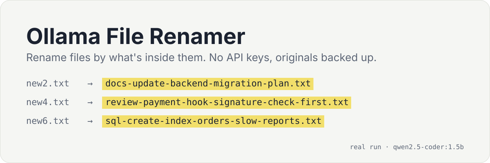
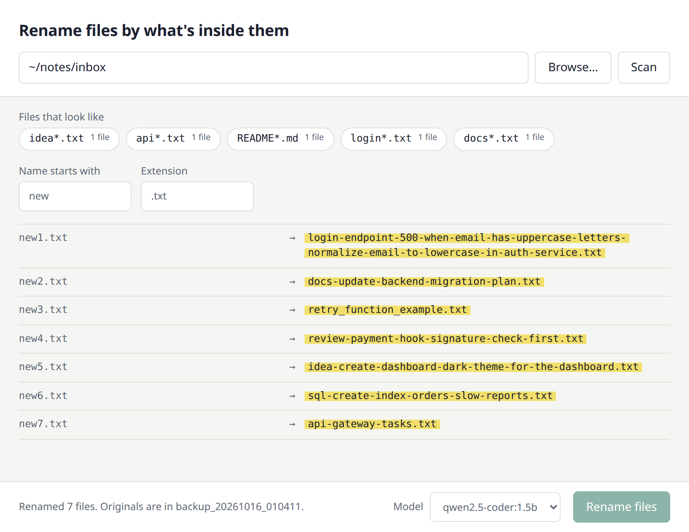

# Ollama File Renamer

<p align="center">
  <a href="https://github.com/octrow/ollama-rename-files/actions/workflows/ci.yml"></a>
  <a href="https://pypi.org/project/ollama-rename-files/"></a>
  <a href="LICENSE"></a>
</p>

<p align="center"></p>

<p align="center"><b>English</b> | <a href="README.ru.md">Русский</a></p>

Rename messy files by their content with a local Ollama model.

`new2.txt` becomes `docs-update-backend-migration-plan.txt`. It runs as a desktop window or a command-line tool.
It needs no API keys and copies every original to a backup folder first.

Made for folders of notes and drafts named `Untitled`, `new`, `copy (3)`.

<p align="center"></p>

## Features

- File contents go only to your own Ollama.
- Originals are copied to `backup_<timestamp>/` first. A rename never overwrites a file: it adds `-1`, `-2`, ...
- The desktop window shows exactly which files will change, then fills in each new name.
- It groups the folder into patterns (`new*.txt`, `Untitled*.md`). Pick one or type a prefix and extension.
- Any installed model works. Reasoning models too: their `<think>` output is stripped.
- The CLI renames several files at once (`-p 4`).
- Reads text files and the text layer of PDFs (`--ext .pdf`). Scanned PDFs, binary and empty files are skipped with a reason.

## Install

You need [Ollama](https://ollama.com/download) running with one model pulled:

```bash
ollama pull qwen2.5-coder:7b
```

Then install the app. It sets up [uv](https://docs.astral.sh/uv/), Python and `ollama-rename` in your user folder, no admin rights needed.

macOS / Linux:

```bash
curl -LsSf https://raw.githubusercontent.com/octrow/ollama-rename-files/main/install.sh | sh
```

Windows (PowerShell):

```powershell
powershell -ExecutionPolicy ByPass -c "irm https://raw.githubusercontent.com/octrow/ollama-rename-files/main/install.ps1 | iex"
```

Have Python 3.10+? Run `uv tool install ollama-rename-files` (or `pipx install ollama-rename-files`).

Other ways, updating and uninstalling: [docs/install.md](docs/install.md). Standalone builds are on the
[releases page](https://github.com/octrow/ollama-rename-files/releases/latest).

## Usage

Open the desktop window:

```bash
ollama-rename gui
```

Browse to a folder, pick a pattern, choose a model and click **Rename N files**. **Stop** halts the run after the current file.

Or use the command line:

```bash
# Interactive: asks for folder, pattern, model and context length
ollama-rename

# No prompts: every new*.txt file in the folder, four at a time
ollama-rename -a -d ~/notes/inbox --prefix new --ext .txt -p 4
```

Ollama on another machine? Set `OLLAMA_HOST`, e.g. `OLLAMA_HOST=http://192.168.1.20:11434 ollama-rename`.

All options, the window's port and Linux notes: [docs/usage.md](docs/usage.md).

## How it works

1. Finds files that match the pattern: the prefix as a whole word (`new` takes `new1.txt`, not `newsletter.txt`) and the extension.
2. Copies each file into `backup_<timestamp>/` in that folder.
3. Sends the first `--context` characters of the file (of its text, for a PDF) to your Ollama model.
4. Picks the name out of the reply and cleans it: lowercase, safe characters, at most 128 characters.
5. Renames the file, keeping its extension and never overwriting.
6. Logs every action and lists the files that failed and why.

Names look like `task-fix-backend-resolve-database-connection-issue.txt`. The naming pattern and the prompt are in [docs/usage.md](docs/usage.md).
Full step-by-step map of the code: [docs/logic-map.md](docs/logic-map.md).

## How it differs from ai-renamer

[ai-renamer](https://github.com/ozgrozer/ai-renamer) is a popular Node.js CLI. It also renames images and videos, and it talks to Ollama, LM Studio and OpenAI.
Pick it for photos or a cloud model.

Ollama File Renamer does less: text files, PDFs and local Ollama only.
It adds a window that previews the exact files, a backup of every original, no overwriting, and pattern discovery.

## Development

```bash
uv sync
uv run pytest
uv run ruff check .
```

See [CONTRIBUTING.md](CONTRIBUTING.md). Security reports go through [SECURITY.md](SECURITY.md).

## License

[MIT](LICENSE)
