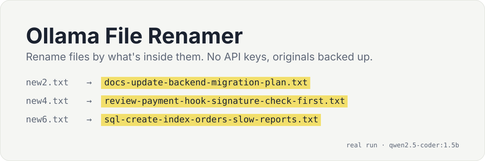
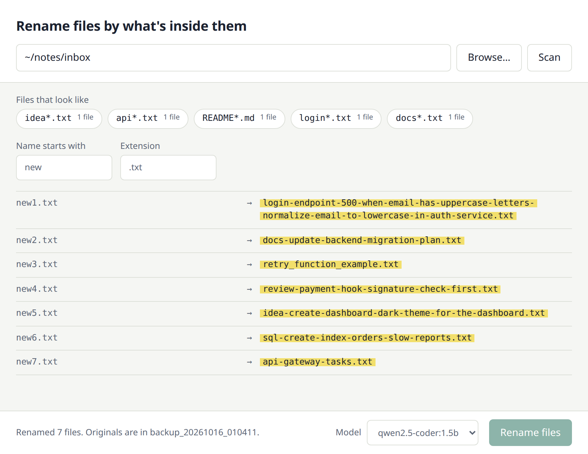

# Ollama File Renamer

<p align="center">
  <a href="https://github.com/octrow/ollama-rename-files/actions/workflows/ci.yml"></a>
  <a href="https://github.com/octrow/ollama-rename-files/releases/latest"></a>
  
  <a href="LICENSE"></a>
</p>

<p align="center"></p>

<p align="center"><b>English</b> | <a href="README.ru.md">Русский</a></p>

Rename messy files by their content with a local Ollama model. `new2.txt` becomes
`docs-update-backend-migration-plan.txt`, `new6.txt` becomes `sql-create-index-orders-slow-reports.txt`. It runs as a desktop window
or a command-line tool, needs no API keys, and copies every original to a backup folder before touching it.

It's for anyone with a folder of notes, snippets and drafts named `Untitled`, `new`, `copy (3)`: developers,
writers, people who dump quick notes into one inbox folder.

<p align="center"></p>

## Features

- Runs on your machine: file contents go only to your own Ollama.
- Originals are copied to `backup_<timestamp>/` inside the folder first, and a rename never overwrites an existing file (it adds `-1`, `-2`, ...).
- In the desktop window you pick a folder, see exactly which files will change, then watch each row get its new name.
- It groups the folder into patterns (`new*.txt`, `Untitled*.md`); you choose one or type a prefix and extension.
- Works with any model you have installed in Ollama. Reasoning models work too: their `<think>` output is stripped.
- The CLI can rename several files at once (`-p 4`).
- Reads text files and the text layer of PDFs (`--ext .pdf`). Scanned PDFs without text and other
  binary files are skipped with a reason.

## Install

You need [Ollama](https://ollama.com/download) running with one model pulled:

```bash
ollama pull qwen2.5-coder:7b
```

Then install the app with one command. It installs [uv](https://docs.astral.sh/uv/), Python and `ollama-rename`
into your user folder, no admin rights needed.

### macOS / Linux

```bash
curl -LsSf https://raw.githubusercontent.com/octrow/ollama-rename-files/main/install.sh | sh
```

### Windows (PowerShell)

```powershell
powershell -ExecutionPolicy ByPass -c "irm https://raw.githubusercontent.com/octrow/ollama-rename-files/main/install.ps1 | iex"
```

Prefer to read it first? Download [`install.sh`](install.sh) or [`install.ps1`](install.ps1), look through it, then run it.
Run it again to update; `sh install.sh --uninstall` (or `$env:INSTALL_UNINSTALL = "1"` on Windows) removes the app.

### Standalone build

No Python needed: download the archive for your system from the
[latest release](https://github.com/octrow/ollama-rename-files/releases/latest) (Linux x86_64 and arm64, macOS on
Apple silicon, Windows), unpack it and run `ollama-rename gui` from the unpacked folder. The builds aren't signed,
so macOS asks you to allow the app in System Settings → Privacy & Security on the first run.

### From source

```bash
git clone https://github.com/octrow/ollama-rename-files.git
cd ollama-rename-files
uv sync
uv run ollama-rename gui
```

## Usage

### Desktop window

```bash
ollama-rename gui
```

Browse to a folder, pick a discovered pattern or type a prefix and extension, and the window lists exactly which
files will change. Choose an installed model and click **Rename N files**: each row fills in with its new name as the
model answers, and **Stop** halts the run after the current file.

The window shows a local page served at `http://127.0.0.1:5000` (change with `--port` or `FILE_RENAMER_PORT`). If that
port is taken by another app, the next free one is used. If File Renamer itself is already running there, you get its
link and a `Restart it? [y/N]` prompt (No by default, and always No without a terminal). `ollama-rename gui --browser`
serves the page without opening a window.

On Linux the window needs Qt or GTK bindings for Python. Without them `ollama-rename gui` opens the same page in
your default browser. For a native window in a source checkout: `uv pip install "pywebview[qt]"`, or install the
system GTK bindings (`python3-gi`). Windows and macOS work out of the box.

### Command line

```bash
# Interactive: asks for the folder, the file pattern, the model and the context length
ollama-rename

# A folder, a model and 500 characters of each file
ollama-rename -d ~/notes/inbox -m qwen2.5-coder:7b -c 500

# No prompts: every new*.txt file in the folder
ollama-rename -a -d ~/notes/inbox --prefix new --ext .txt

# Four files at a time
ollama-rename -d ~/notes/inbox -p 4
```

| Option        | Short | Description                                                                     |
|---------------|-------|---------------------------------------------------------------------------------|
| `--auto`      | `-a`  | Run without interactive prompts. Requires `-d`.                                 |
| `--directory` | `-d`  | Folder with the files to rename.                                                |
| `--model`     | `-m`  | Ollama model to use (default `qwen2.5-coder:7b`).                               |
| `--context`   | `-c`  | How many characters of each file to send to the model (default 2048).           |
| `--prefix`    |       | File name prefix to match (default `new`). Used with `--ext` as the pattern.    |
| `--ext`       |       | File extension to match, with the dot (default `.txt`).                         |
| `--parallel`  | `-p`  | Files renamed at the same time. 0 (default) means one by one.                   |

Ollama on another machine or port? Set `OLLAMA_HOST`, e.g. `OLLAMA_HOST=http://192.168.1.20:11434 ollama-rename`.

## How it works

1. Finds the files in the folder that match the pattern (prefix and extension).
2. Creates `backup_<timestamp>/` in that folder and copies each file there before renaming it.
3. Sends the first `--context` characters of the file (for a PDF, of its extracted text) to your local Ollama model.
4. Cleans the suggested name: lowercase, safe characters, at most 128 characters.
5. Renames the file, keeping its original extension and never overwriting an existing file.
6. Logs every action and prints which files failed and why.

Names follow the pattern `<type>-<action>-<component>-<short-description>`, for example:

- `task-fix-backend-resolve-database-connection-issue.txt`
- `doc-update-project-architecture-notes.md`

The prompt is tuned for software-project notes: type is task, issue, doc, snippet, review or idea. It lives in
`PROMPT_TEMPLATE` in [`rename_files.py`](src/ollama_rename_files/rename_files.py) if you want other names.

## How it differs from ai-renamer

[ai-renamer](https://github.com/ozgrozer/ai-renamer) is a popular Node.js CLI that does the same job and more: it
also renames images and videos, and it talks to Ollama, LM Studio and OpenAI. Pick it if you rename photos or want a
cloud model.

Ollama File Renamer is narrower: text files, PDFs and local Ollama only. What it adds is a desktop window with a preview of
the exact files that will change, a backup copy of every original, renames that never overwrite, and pattern
discovery so you rename `new*.txt` without touching the rest of the folder.

## Development

```bash
uv sync
uv run pytest
uv run ruff check .
```

See [CONTRIBUTING.md](CONTRIBUTING.md). Security reports go through [SECURITY.md](SECURITY.md).

## License

[MIT](LICENSE)
