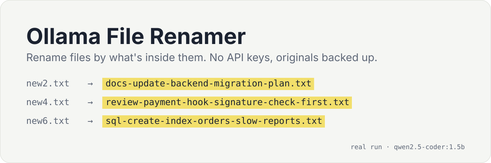
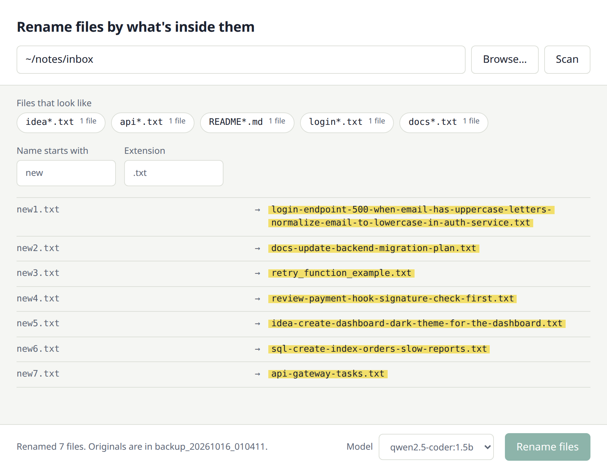

# Ollama File Renamer

<p align="center">
  <a href="https://github.com/octrow/ollama-rename-files/actions/workflows/ci.yml"></a>
  <a href="https://pypi.org/project/ollama-rename-files/"></a>
  <a href="LICENSE"></a>
</p>

<p align="center"></p>

<p align="center"><a href="README.md">English</a> | <b>Русский</b></p>

Переименовывает файлы по содержимому с помощью локальной модели Ollama.

`new2.txt` превращается в `docs-update-backend-migration-plan.txt`. Работает в окне или в командной строке.
API-ключи не нужны, каждый исходный файл сначала копируется в папку бэкапа.

Для папок с заметками и черновиками вида `Untitled`, `new`, `копия (3)`.

<p align="center"></p>

## Возможности

- Содержимое файлов уходит только в ваш Ollama.
- Оригиналы сначала копируются в `backup_<timestamp>/`. Переименование не перезаписывает файлы: добавляется `-1`, `-2`, ...
- Окно показывает, какие именно файлы изменятся, и по очереди заполняет новые имена.
- Папка группируется по шаблонам (`new*.txt`, `Untitled*.md`). Выберите один или введите префикс и расширение.
- Подходит любая установленная модель. Рассуждающие тоже: их вывод `<think>` отбрасывается.
- CLI переименовывает несколько файлов сразу (`-p 4`).
- Читает текстовые файлы и текстовый слой PDF (`--ext .pdf`). Сканы PDF, двоичные и пустые файлы пропускаются с указанием причины.

## Установка

Нужен запущенный [Ollama](https://ollama.com/download) с одной скачанной моделью:

```bash
ollama pull qwen2.5-coder:7b
```

Дальше поставьте приложение. Оно установит [uv](https://docs.astral.sh/uv/), Python и `ollama-rename` в вашу папку, права администратора не нужны.

macOS / Linux:

```bash
curl -LsSf https://raw.githubusercontent.com/octrow/ollama-rename-files/main/install.sh | sh
```

Windows (PowerShell):

```powershell
powershell -ExecutionPolicy ByPass -c "irm https://raw.githubusercontent.com/octrow/ollama-rename-files/main/install.ps1 | iex"
```

Есть Python 3.10+? Выполните `uv tool install ollama-rename-files` (или `pipx install ollama-rename-files`).

Другие способы, обновление и удаление: [docs/install.ru.md](docs/install.ru.md). Готовые сборки лежат на
[странице релизов](https://github.com/octrow/ollama-rename-files/releases/latest).

## Использование

Откройте окно приложения:

```bash
ollama-rename gui
```

Укажите папку, выберите шаблон и модель, нажмите **Rename N files**. **Stop** останавливает прогон после текущего файла.

Или работайте из командной строки:

```bash
# Интерактивно: спросит папку, шаблон, модель и длину контекста
ollama-rename

# Без вопросов: все файлы new*.txt в папке, по четыре сразу
ollama-rename -a -d ~/notes/inbox --prefix new --ext .txt -p 4
```

Ollama на другой машине? Задайте `OLLAMA_HOST`, например `OLLAMA_HOST=http://192.168.1.20:11434 ollama-rename`.

Все параметры, порт окна и заметки про Linux: [docs/usage.ru.md](docs/usage.ru.md).

## Как это работает

1. Находит файлы под шаблон: префикс как целое слово (`new` берёт `new1.txt`, но не `newsletter.txt`) и расширение.
2. Копирует каждый файл в `backup_<timestamp>/` в этой папке.
3. Отправляет первые `--context` символов файла (для PDF - его текста) в вашу модель Ollama.
4. Находит имя в ответе и чистит его: нижний регистр, безопасные символы, не длиннее 128 символов.
5. Переименовывает файл, сохраняя расширение и ничего не перезаписывая.
6. Пишет в лог каждое действие и перечисляет файлы, которые не удалось переименовать, с причиной.

Имена выглядят так: `task-fix-backend-resolve-database-connection-issue.txt`. Шаблон имён и промпт: [docs/usage.ru.md](docs/usage.ru.md).
Подробная карта кода по шагам: [docs/logic-map.ru.md](docs/logic-map.ru.md).

## Чем отличается от ai-renamer

[ai-renamer](https://github.com/ozgrozer/ai-renamer) - популярный CLI на Node.js. Он переименовывает ещё и картинки с видео, работает с Ollama, LM Studio и OpenAI.
Берите его для фотографий или облачной модели.

Ollama File Renamer умеет меньше: только текстовые файлы, PDF и локальный Ollama.
Зато в нём есть окно с предпросмотром файлов, бэкап каждого оригинала, переименование без перезаписи и поиск шаблонов.

## Разработка

```bash
uv sync
uv run pytest
uv run ruff check .
```

Подробнее в [CONTRIBUTING.ru.md](CONTRIBUTING.ru.md). Об уязвимостях сообщайте по [SECURITY.ru.md](SECURITY.ru.md).

## Лицензия

[MIT](LICENSE)
