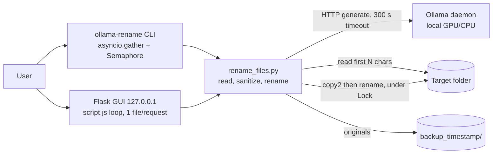

# System design: ollama-rename-files

Review of an existing system, mode "existing system" of the system-design skill. Companion to [logic-map.md](logic-map.md) (flow, branches, known gaps [20]-[24]); not repeated here.

## Assumptions

- Kind: local CLI plus a localhost Flask GUI (`ollama-rename gui`). No server tier, no DB, no cache, no queue. One user, one machine. Steps 3 (API contract) and the cache part of 5 are n/a.
- measured (git log): 62 commits, first 2024-12-02, 31 of them on 2026-11-01. Active development, no deployment history.
- measured (wc -l): `rename_files.py` 553, `app.py` 284, `static/script.js` 261 lines. Deps in `pyproject.toml`: ollama client, pypdf, Flask.
- measured (logic-map.md, code): LLM call is `num_predict=128`, client timeout 300 s (`rename_files.py:192`), per-file, no retry.
- assumed: a run is 20-200 files, up to 5000 for a big archive folder (user-supplied folder, not measured; there are no run logs, the tool writes none).
- assumed: one Ollama generate call is 2-5 s for a 7B model on a local GPU with a 4096-token context, 10-30 s on CPU only. Not measured: Ollama is not called in this review.
- assumed: files are small text or PDF; the content sent is at most `-c` characters (default 2048, GUI fixed 2048).

## 0. What exists

- Entry points: `ollama-rename` (CLI, interactive or `-a`), `ollama-rename gui` (Flask on 127.0.0.1:5000, pywebview or browser). See logic-map "Entry points".
- Stack: Python, `asyncio` + `ollama.AsyncClient` (CLI), Flask dev server (GUI), `pypdf`, `shutil.copy2`. Ollama is a separate local daemon (`OLLAMA_HOST`).
- Deploy: `install.sh` / `install.ps1`, a user-level install. No compose, systemd, cron.
- State: none besides files. Backup is a `backup_<timestamp>/` folder inside the target folder.
- Ladder rung today: rung 0/1, a single process on one machine. This is the correct rung: the napkin below needs less than one VPS-worth of anything.

## 1. Requirements

One sentence: rename the files of one folder by what is inside them, using a local LLM, reversibly.

- Functional: discover patterns, select files, read text/PDF, ask the model, rename without overwriting, keep originals in a backup folder. Out of scope: recursion, other file types (images, DOCX), remote/multi-user use, undo command.
- Non-functional (assumed unless noted):
  - Scale: 1 user, up to 5000 files per run, a few runs a week.
  - Latency: no target per file; a run of N files is N x model latency / parallelism. Progress visible every 10 files (CLI).
  - Availability: downtime is fine; a run may be restarted.
  - Consistency: the rename plus backup must never lose an original and never overwrite a file (enforced, `rename_files.py:387-400`).
  - Durability: the backup copy is the only copy of the old name and content; a failed run leaves already-renamed files renamed.
  - Security: GUI is localhost-only with a Host header check (logic-map "GUI request guard"). File content goes only to the local Ollama.
  - Observability: stderr/log lines per file, a summary at the end. No persisted run log.

## 2. Napkin math

A "request" is one file = one LLM call. One run = one "user-day". Server throughput is the model's, assumed 0.3 files/s (about 3 s per file, serial).

```
$ napkin.py --dau 1 --req-per-user 200 --peak 1 --server-rps 0.3 --write-kb 1 --response-kb 1 --retention-years 1
requests/day 200 | average 0.0 req/s | app tier 2 servers @ 0.3 req/s
writes at peak 0.0 req/s | shards 1 | replicas 0 | storage per year 21.9MB
verdict: rungs 1-2: one good VPS. Ship it.

$ napkin.py --dau 1 --req-per-user 5000 --peak 1 --server-rps 0.3 --write-kb 1 --response-kb 1 --retention-years 1 --hit-rate 0
requests/day 5.0k | average 0.1 req/s | app tier 2 servers @ 0.3 req/s
```

Hand-readable result (script output above, assumed 3 s/file): 200 files about 10 min serial, 5000 files about 4.2 h serial. The "2 servers" is the script's spare-server rule, not a need: the single Ollama process is one GPU. The cost is wall-clock time, not capacity. Storage: the backup folder equals the size of the renamed files (1x copy), not the napkin's 1 KB/write; that is the real disk cost (see Risks).

## 3. API contract

n/a for the CLI. GUI has an internal Flask API (`/set_directory`, `/models`, `/preview`, `/rename_file`, `/health`) used only by its own JS; see `app.py`. One file per `/rename_file` call, no idempotency key (a repeat call renames from the current name, which is harmless: it picks a free name).

## 4. High-level architecture

Rung 0/1. All boxes are real.



Box reasons:
- Ollama daemon: the only slow dependency; it loads the model once per run because `num_ctx` is one value per run (logic-map step 7).
- `threading.Lock` around copy plus rename: two workers must not pick the same free name (`rename_files.py:86`, `:393`).
- Backup folder: durability requirement (originals recoverable).
- No queue, DB, cache: a run is short, restartable and has no cross-run state.

## 5. Data

No DB. The "data" is the folder:
- Read path: first `limit x 4` bytes for text (`:170`); PDFs: pages until `limit` chars (`:162-165`), so one page of an image-heavy PDF can still be slow to extract. Cost is bounded by the context limit, not file size, except the `copy2`.
- Write path: `copy2` to backup, then `rename` (atomic on the same filesystem). Name uniqueness via `unique_path` under the lock; two processes on one folder still race (logic-map step 10).
- Cache: none. A re-run recomputes every call. Model output is not deterministic enough to cache by content hash and a second run on renamed files would not select the same files anyway. Not worth adding.

## 6. Scale and failure

x10 (a 2000-file run instead of 200):
- First to saturate: Ollama inference throughput. 2000 files at 3 s serial = 100 min (assumed). Wall clock grows linearly.
- CLI `-p N` only helps if Ollama has `OLLAMA_NUM_PARALLEL` > 1 and enough VRAM; otherwise requests queue inside Ollama and the 300 s client timeout starts counting while a request waits (`rename_files.py:192`). With `-p 8` on a slow CPU model, a file late in the queue can hit "didn't answer in 300 s" without being slow itself.
- GUI is strictly 1 file per request, serial, so it is the slower path for big folders.
- `asyncio.gather` creates one task per file at once (`:447`); 5000 tasks is cheap. No memory problem.

Failure behaviour:
- Ollama down or model missing: every file fails fast with a clear message; run ends, exit 0 (gap [22]).
- Ollama slow (8 s per call): fine at 1 worker. At high `-p` see the queueing timeout above.
- Ollama hangs: 300 s per file per attempt, no retry, no circuit breaker. 100 files x 300 s = 8 h of waiting if the daemon is stuck rather than dead. GUI Stop waits up to 300 s.
- Disk full during `copy2`: that file fails (OSError), the original is kept; a partial copy may stay in the backup folder.
- Crash or Ctrl+C mid-run: finished files stay renamed, in-flight ones are untouched, backup folder kept if non-empty. There is no resume list and no undo command; recovery is by hand from the backup folder.
- Retry/backoff: none by design; a failed file is just reported.
- Backups: this tool is the backup mechanism; the backup folder is not itself protected and is not skipped by a later run on the same folder (files directly in the folder only, so `backup_*/` contents are not touched, correct).
- Single machine loss: n/a, no state.

## 7. Trade-offs

- Local LLM over a hosted API: privacy and zero cost, paid for with minutes per hundred files and a hard dependency on a running daemon.
- Per-file independent calls, no retry: simple and failures isolated, but a transient error costs the user a manual re-run (the failed file is renamed on the next run only if it still matches the pattern).
- Copy-then-rename backup: safe, costs 2x disk of the processed set and a synchronous copy.
- Process-wide lock: correct for one process, does nothing across processes.
- Flask dev server, 1 file per HTTP call: fine for one local user, would not survive being exposed (it is not: 127.0.0.1 plus Host check).
- No persisted log: nothing to rotate, but also no record of which names changed when the terminal closes (the backup folder holds originals only, not a mapping).

## 8. Summary

- Design in three lines: one local process, one slow dependency (Ollama), state kept as files plus a backup folder. Right rung for one user; nothing to scale out.
- Assumptions that would change it: runs over about 5000 files (needs a resume list and a persisted old-to-new mapping), a hung-daemon case being common (needs a retry and a per-run abort), or running it against network or very large files (backup cost).
- Next rung trigger: this stays a single-process tool. Add a persisted run manifest (old name, new name, status) when a run regularly exceeds about 30 min, since that is when losing the terminal or restarting becomes costly. Do not add a queue or DB before that.

## Risks

- MEDIUM, `rename_files.py:392-396`: backup is a full `copy2` of each file with no free-space check and runs synchronously inside the async worker while holding the lock. A large file (hundreds of MB) blocks the event loop and every other worker for the copy duration and may fill the disk mid-run. Bound: skip or warn above a size threshold, move the copy off the loop.
- MEDIUM, `rename_files.py:192`, `:355-365`: 300 s timeout with no retry and no run-level abort. With `-p` above Ollama's parallelism, queue wait counts against the timeout; with a hung daemon a big run stalls for hours. Add a consecutive-failure abort and a retry for timeouts.
- MEDIUM, `rename_files.py:447`: no run manifest or undo. After an interrupted or wrong run the only record is the backup folder (originals, original names) and nothing maps new names back. Write a small JSON manifest into the backup folder.
- LOW, `rename_files.py:423-447`: `-p` default 0 means 1; the user gets no hint that parallelism needs `OLLAMA_NUM_PARALLEL`. Documentation only.
- LOW, `app.py` + `static/script.js`: GUI serial loop, one HTTP call per file; for 1000+ files the GUI is the slow path. Known GUI race: logic-map gap [20].
- LOW, `rename_files.py:86`: lock is per process; two simultaneous runs on one folder can collide on names (logic-map step 10).
- LOW, exit codes: CLI exits 0 when all files failed (gap [22]); matters if the tool is ever scripted.
